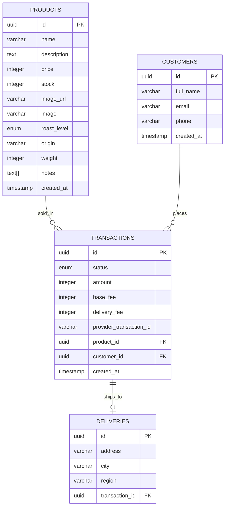
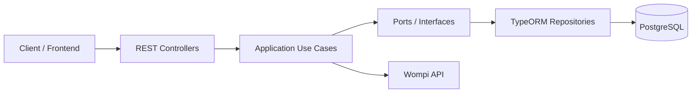

# Coffee Shop E-commerce Backend

Backend for the Origen Coffee e-commerce, built with NestJS, TypeORM and PostgreSQL. The API exposes the public product catalog, processes payments with Wompi, registers customers, creates deliveries and generates the receipt for each transaction.


## Table of contents

- [Overview](#overview)
- [Swagger](#swagger)
- [Relational diagram](#relational-diagram)
- [Architecture](#architecture)
- [Coverage](#coverage)
- [Running the app](#running-the-app)
- [GitHub Actions](#github-actions)

## Overview

### What this API does

- Lists products available for purchase.
- Retrieves the detail of a product by `id`.
- Processes payments against Wompi, validating the total calculated by the backend.
- Creates or reuses customers on each checkout.
- Registers the delivery associated with the transaction.
- Allows retrieving the receipt of a purchase.

### Relevant business rules

- The backend does not trust the total sent by the frontend: it recalculates the amount to charge.
- The total is made up of:
  `product price + 1,500 COP (base fee) + 12,000 COP (delivery fee)`.
- The amount sent to the provider is validated in cents.
- If the payment ends up `APPROVED`, stock is decremented.
- If the provider rejects the purchase, the transaction is marked as `FAILED`.

### Main stack

- NestJS 11
- TypeORM 0.3
- PostgreSQL
- Swagger (`@nestjs/swagger`)
- Jest for tests and coverage
- GitHub Actions for CI/CD
- Docker + Amazon ECR/ECS for deployment

### Main endpoints

| Method | Route | Description |
| --- | --- | --- |
| `GET` | `/products` | Lists the public catalog with available products |
| `GET` | `/products/:id` | Returns the full detail of a product |
| `POST` | `/transactions` | Processes the checkout and creates the transaction |
| `GET` | `/transactions/:id` | Retrieves the receipt of a transaction |

## Swagger

- https://api-coffee-shop.jdvalencir.com/docs#/

The OpenAPI documentation is generated automatically when the application starts and is served at:

- `http://localhost:3000/docs`

Current configuration:

- Title: `Origen Coffee E-commerce API`
- Version: `1.0`
- Mount path: `/docs`


### Expected checkout payload

The `POST /transactions` endpoint receives:

- `amount`: amount in cents
- `cardToken`: card token issued by Wompi
- `productId`: product UUID
- `fullName`
- `email`
- `phone`
- `address`
- `city`
- `region`

## Relational diagram



### Key relationships

- A product can be associated with many transactions.
- A customer can make many transactions.
- A transaction can have one associated delivery.
- `deliveries.transaction_id` is `UNIQUE`, so the relationship with `transactions` is one-to-one.

## Architecture

The project is split into business modules with a structure close to hexagonal / clean architecture:

- `application`: use cases and contracts (ports).
- `domain`: errors and domain rules.
- `infraestructure`: controllers, external adapters, TypeORM repositories, entities and DTOs.
- `core`: injection tokens, shared errors, HTTP filters and utilities.



### Modules

- `StockModule`: catalog and product detail queries.
- `CustomersModule`: persistence and lookup/creation of customers.
- `DeliveriesModule`: persistence of delivery information.
- `TransactionsModule`: checkout, Wompi integration and receipts.

### Payment flow

1. The controller receives the checkout.
2. The use case validates the product and its stock.
3. It recalculates the total to pay on the backend.
4. It creates or reuses the customer.
5. It registers a `PENDING` transaction.
6. It creates the associated delivery.
7. It calls Wompi through `WompiApiAdapter`.
8. It updates the transaction status.
9. If the payment was approved, it decrements stock.

### Deployment diagram


## Coverage

Local report taken from `coverage/lcov-report/index.html`.

| Metric | Result | Coverage |
| --- | --- | --- |
| Statements | `356/358` | `99.44%` |
| Branches | `108/131` | `82.44%` |
| Functions | `50/51` | `98.03%` |
| Lines | `322/324` | `99.38%` |

The project defines a global minimum threshold of `80%` for:

- statements
- branches
- functions
- lines


## Running the app

### Prerequisites

- Node.js 22 recommended
- pnpm 10
- PostgreSQL

### Environment variables

You can start from `.env.example`:

```bash
cp .env.example .env
```

Variables used by the application:

| Variable | Description | Default / example |
| --- | --- | --- |
| `DB_HOST` | PostgreSQL host | `localhost` |
| `DB_PORT` | PostgreSQL port | `5433` in `.env.example` |
| `DB_USER` | DB user | `postgres` |
| `DB_PASSWORD` | DB password | `postgres` |
| `DB_NAME` | DB name | `coffee_shop` |
| `PORT` | API HTTP port | `3001` in `.env.example` |
| `NODE_ENV` | Runtime environment | `development` |
| `WOMPI_API_URL` | Wompi base URL | sandbox |
| `WOMPI_PUBLIC_KEY` | Wompi public key | example |
| `WOMPI_PRIVATE_KEY` | Wompi private key | example |
| `WOMPI_INTEGRITY_KEY` | Wompi integrity key | example |

### Installation

```bash
pnpm install
```

### Initialize the database

Run migrations:

```bash
pnpm run migration:run
```

Load the initial catalog:

```bash
pnpm run seed:run
```

The seeder inserts products only if the `products` table is empty.

### Run in development

```bash
pnpm run start:dev
```

Other variants:

```bash
pnpm run start
pnpm run start:debug
pnpm run build
pnpm run start:prod
```

### Run tests

```bash
pnpm run test
pnpm run test:unit
pnpm run test:cov
pnpm run test:e2e
```

### Recommended order to bring the project up

1. Configure `.env`.
2. Start PostgreSQL.
3. Run `pnpm install`.
4. Run `pnpm run migration:run`.
5. Run `pnpm run seed:run`.
6. Run `pnpm run start:dev`.
7. Open `http://localhost:3001/docs`.

## GitHub Actions

The CI/CD workflow is defined in `.github/workflows/deploy-aws.yml`.

### When it runs

- On every `push` to the `main` branch.
- Manually from GitHub with `workflow_dispatch`.

### Pipeline structure

#### Job `verify`

This job checks that the project is healthy before deploying:

1. Checks out the repository.
2. Sets up `pnpm` 10.
3. Sets up Node.js 22.
4. Runs `pnpm install --frozen-lockfile`.
5. Runs `pnpm run build`.
6. Runs `pnpm run test:unit:cov`.

#### Job `deploy`

Runs only if `verify` succeeds.

1. Checks out the repository.
2. Configures AWS credentials.
3. Logs in to Amazon ECR.
4. Builds the Docker image using the `Dockerfile`.
5. Pushes the image to ECR, tagged with the commit SHA.
6. Runs migrations inside the container with `pnpm run migration:run:prod`.
7. Runs the compiled seeder with `pnpm run seed:run:prod`.
8. Downloads the current task definition (`coffee-shop-api-task`).
9. Replaces the image of the target container.
10. Deploys the new revision to Amazon ECS.

### Required variables and secrets

#### Repository variables

- `AWS_REGION`
- `ECR_REPOSITORY`
- `ECS_CLUSTER`
- `ECS_SERVICE`
- `ECS_CONTAINER_NAME`

#### Repository secrets

- `AWS_ACCESS_KEY_ID`
- `AWS_SECRET_ACCESS_KEY`
- `DB_HOST`
- `DB_PORT`
- `DB_USER`
- `DB_PASSWORD`
- `DB_NAME`

### Important workflow considerations

- The name of the queried task definition is hardcoded as `coffee-shop-api-task`.
- Migrations and seeders run on every deployment.
- The seeder does not duplicate products if data already exists in `products`.
- The deployment waits for service stability (`wait-for-service-stability: true`).


## Base project structure

```text
src/
  core/
  database/
    config/
    migrations/
    seeds/
  modules/
    customers/
    deliveries/
    products/
    transactions/
```

## Additional notes

- Swagger is mounted automatically when the app starts.
- TypeORM uses `synchronize: false`; migrations are the source of truth.
- If `DB_HOST` contains `rds`, the connection enables SSL.
- The payment gateway uses Wompi sandbox by default.
